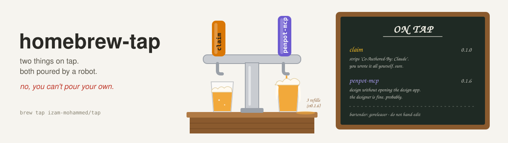

<picture>
  <source media="(prefers-color-scheme: dark)" srcset="assets/banner-dark.svg">
  <source media="(prefers-color-scheme: light)" srcset="assets/banner-light.svg">
  
</picture>

# homebrew-tap
homebrew formulas for my things ~ generated by goreleaser, don't hand-edit
